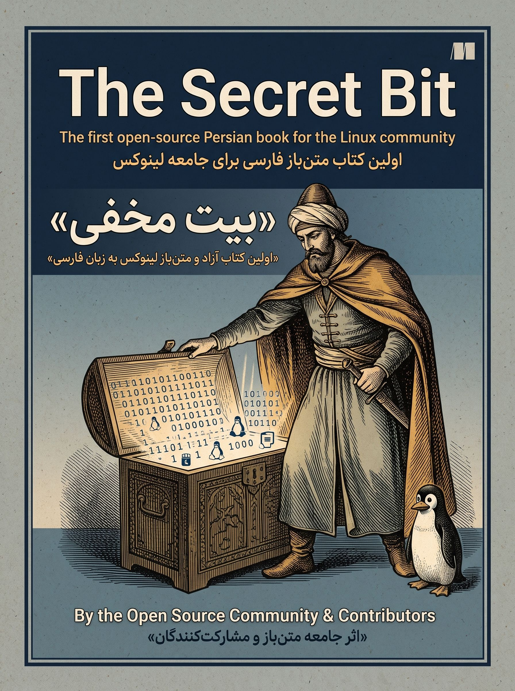

<div dir="rtl">

<p align="center">
  <a href="https://hheydarian.github.io/Gitab/">
    
  </a>
</p>

<h1 align="center">🐧 دانشنامه جامع و آزاد ابزارهای لینوکس: راز بیت (The Secret Bit)</h1>

<p align="center">
  <strong>اولین کتاب آزاد و جامعه‌محور فارسی برای درک عمیق مفاهیم بنیادین یونیکس و تسلط بر بیش از ۶۶ ابزار حیاتی خط فرمان لینوکس</strong>
</p>

<p align="center">
  
  
  
  
  
</p>

---

## 💡 چرا این پروژه؟

در دنیای مهندسی نرم‌افزار، لینوکس قلب تپنده زیرساخت‌ها، سرورها و محیط‌های ابری است. اما بیشتر منابع آموزشی صرفاً به معرفی سطحی سینتکس دستورات بسنده می‌کنند. **کتاب راز بیت (The Secret Bit)** با هدفی فراتر متولد شده است:
* 🎯 **درک عمیق فلسفه یونیکس:** چرا و چگونه ابزارهای خط فرمان کوچک ساخته شده‌اند تا کارهای شگفت‌انگیز بزرگ انجام دهند.
* 🛠️ **آموزش عملی بیش از ۶۶ ابزار حیاتی:** از مفاهیم اولیه پایپ‌ها، ریدایرکشن و متغیرها تا ابزارهای پیشرفته مدیریت پروسه‌ها، شبکه و دیسک.
* 🌍 **کتابی آزاد برای جامعه، توسط جامعه:** تلاشی جمعی به سرپرستی *محمد شبانه* و مشارکت توسعه‌دهندگان متن‌باز برای غنی‌سازی منابع فارسی لینوکس.

---

<p align="center">

## ⚡ دسترسی سریع

| مرجع | توضیحات | لینک |
| :--- | :--- | :---: |
| 📖 **نسخه وب تعاملی (گیتاب)** | تجربه خواندن زیبا با حالت تاریک/روشن، جستجوی سریع و فونت استاندارد | [ورود به گیتاب ↗](https://hheydarian.github.io/Gitab/books/book11/) |
| 📥 **سورس مقالات و ابزارها** | پوشه سورس اصلی مقالات و مستندات مارک‌داون کتاب | [مشاهده پوشه Content ↗](content/) |

---
</p>

## 🔍 راهنمای خوانایی بهتر در گیت‌هاب

برای اینکه متون فارسی در گیت‌هاب با قلم استاندارد و چشم‌نواز نمایش داده شوند:
1. افزونه رایگان **[فونت ایران (FontIran)](https://chromewebstore.google.com/detail/fontiran/edbchgkbejkdkdkpgenlaciegoidmjoh)** را روی مرورگر خود نصب کنید.
2. فونت پیش‌فرض را روی **وزیرمتن (Vazirmatn)** یا **ایران‌یکان** قرار دهید تا هماهنگی کدها و توضیحات فارسی بی‌نقص شود.

---

## 📚 سرفصل‌ها و بخش‌های اصلی کتاب

کتاب راز بیت در **۴ بخش بنیادین** سازمان‌دهی شده است:

<div align="center">

| بخش | سرفصل‌ها و مباحث محوری | تعداد ابزارها | وضعیت | مطالعه مستقیم |
| :---: | :--- | :---: | :---: | :---: |
| **بخش ۰** | پیش‌گفتار، چرایی تألیف و راهنمای مشارکت | — | ✅ | [پیش‌گفتار](content/preface.md) |
| **بخش ۱** | مفاهیم بنیادین (پایپ‌ها، متغیرهای محیطی، سطوح دسترسی، شبانگ، فضای نام و سواپ) | ۷ مبحث پایه | ✅ | [مفاهیم پایه](content/concepts/) |
| **بخش ۲** | ابزارهای مدیریت فایل، پردازش متن و جستجو (`grep`, `sed`, `awk`, `find`, `cat`, ...) | ۲۶ ابزار کاربردی | ✅ | [ابزارهای متن و فایل](content/tools/) |
| **بخش ۳** | ابزارهای سیستم، نظارت بر پروسه‌ها، دیسک، شبکه و سخت‌افزار (`top`, `ps`, `df`, `curl`, ...) | ۳۳ ابزار تخصصی | ✅ | [ابزارهای سیستم](content/tools/) |

</div>

---

## 🤝 مشارکت در پروژه (Contributions Welcome)

این دانشنامه یک پروژه آزاد و زنده است. مشارکت شما در تصحیح اشکالات تایپی، به‌روزرسانی دستورات، اضافه کردن مثال‌های کاربردی یا نگارش مستندات ابزارهای جدید با آغوش باز پذیرفته می‌شود:

1. **فورک کنید (Fork):** ریپازیتوری را فورک کرده و یک شاخه اختصاصی بسازید:
   ```bash
   git checkout -b feature/add-new-tool
   ```
2. **اعمال تغییرات:** اصلاحات یا ابزار جدید را مطابق با ساختار پوشه `content/` اضافه کنید.
3. **کامیت و ارسال پول ریکوئست:** تغییرات را با پیامی رسا کامیت کرده و Pull Request ارسال نمایید.

---

## ⚖️ مجوز و حقوق مالکیت معنوی

* **متن و مستندات کتاب:** این اثر تحت مجوز **[Creative Commons Attribution-ShareAlike 4.0 (CC BY-SA 4.0)](https://creativecommons.org/licenses/by-sa/4.0/)** منتشر می‌شود.
* **کدها و اسکریپت‌ها:** کلیه کدهای نمونه تحت مجوز **MIT License** آزاد و در دسترس عموم قرار دارند.

---

<p align="center">
  ⭐ <strong>اگر این دانشنامه به تسلط شما بر لینوکس کمک کرده، با دادن یک ستاره (Star) از پروژه حمایت کنید!</strong> ⭐
</p>

<p align="center">
  توسعه داده شده با ❤️ برای جامعه برنامه‌نویسان و لینوکس‌کارهای فارسی‌زبان
</p>

</div>
